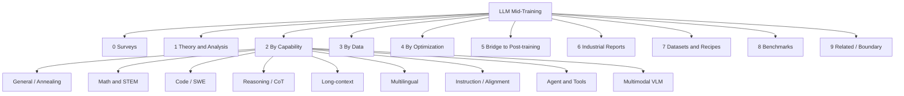

# Awesome Mid-Training for LLMs

[](https://awesome.re)   

**A curated list of papers on mid-training for large language models** — the stage between large-scale general pretraining and post-training (SFT / preference optimization / online RL).

## Operational definition

> **Mid-training** = stage between large-scale general pretraining and post-training (SFT / preference / online RL); mainly an NTP/CE objective (masking allowed); HQ / domain / synthetic data, usually with replay; token budget much larger than typical SFT and smaller than full pretraining; intent = distribution bridging / capability injection / post-training warmup, **not** final alignment.

Includes self-described mid-training, annealing/cooldown-stage data studies, continued pretraining that functions as mid (incl. agentic CPT, math/code CPT), long-context extension stages, theory/analysis, datasets & recipes, industrial reports with a substantive mid section, and mid-oriented evaluation protocols. Boundary cases (env-RL warmups, FireAct/AgentTuning-scale SFT) live in [§9 Related / Boundary](#9-related--boundary).

**Last updated:** 2026-10-23 (Asia/Shanghai) · updated weekly

**Stats:** 204 entries (195 core + 9 boundary). Machine-readable source: [`papers.json`](papers.json). Regenerate this file: `python scripts/build_readme.py`.

## Citation (forthcoming survey)

This list accompanies a general LLM mid-training survey by Tingfeng Hui ([HypherX](https://github.com/HypherX)). BibTeX TBD — placeholder:

```bibtex
@article{hui2026midtraining-survey,
  title   = {A Survey on Mid-Training of Large Language Models},
  author  = {Hui, Tingfeng and others},
  journal = {TBD},
  year    = {2026},
  note    = {Forthcoming}
}
```

## Taxonomy



## Contents

- [Operational definition](#operational-definition)
- [Taxonomy](#taxonomy)
- [2. By Target Capability](#2-by-target-capability)
- [0. Surveys & Position Papers (2)](#0-surveys-position-papers)
- [1. Definition, Theory & Analysis (23)](#1-definition-theory-analysis)
- [2.1 General Quality / Knowledge Annealing (19)](#21-general-quality-knowledge-annealing)
- [2.2 Math & STEM (5)](#22-math-stem)
- [2.3 Code (incl. Repo-level / SWE) (11)](#23-code-incl-repo-level-swe)
- [2.4 Reasoning & CoT (Mid for RL) (12)](#24-reasoning-cot-mid-for-rl)
- [2.5 Long-Context (19)](#25-long-context)
- [2.6 Multilingual (16)](#26-multilingual)
- [2.7 Instruction & Alignment Mid-Training (9)](#27-instruction-alignment-mid-training)
- [2.8 Agent & Tool Use (14)](#28-agent-tool-use)
- [2.9 Multimodal (LLM / VLM Mid-Training) (3)](#29-multimodal-llm-vlm-mid-training)
- [3. By Data (29)](#3-by-data)
- [4. By Optimization (13)](#4-by-optimization)
- [5. Bridge to Post-Training (5)](#5-bridge-to-post-training)
- [6. Industrial Technical Reports (7)](#6-industrial-technical-reports)
- [7. Datasets & Open Recipes (5)](#7-datasets-open-recipes)
- [8. Benchmarks / Evaluation (3)](#8-benchmarks-evaluation)
- [9. Related / Boundary (9)](#9-related-boundary)
- [Industrial mid-stage cheat sheet](#industrial-mid-stage-cheat-sheet)
- [Contributing](#contributing)

## 0. Surveys & Position Papers

*Surveys and position papers that define or map LLM mid-training.*

- **A Survey on LLM Mid-Training** [[paper](https://arxiv.org/abs/2510.23081)] — *arXiv 2025.10* — Systematic survey defining LLM mid-training; data, LR, architecture, objective-driven implementations. `#survey` `#taxonomy`
- **Mid-Training of Large Language Models: A Survey** [[paper](https://arxiv.org/abs/2510.06826)] — *arXiv 2025.10* — Annealing-style mid-training survey: data distributions, LR schedulers, long-context theory. `#survey` `#annealing` `#taxonomy`

## 1. Definition, Theory & Analysis

*Why mid-training works: distribution bridging, plasticity, data timing, decay/annealing scaling.*

- **Data Schedules and Learning Rate Schedules Should Be Designed Together** [[paper](https://arxiv.org/abs/2610.29348)] — *arXiv 2026.10* — Argues data schedules and LR schedules should be designed together. `#data-schedule` `#LR-schedule`
- **Everything in Moderation: Per-Domain Coverage Optima and Alignment-Resistant Domain Gaps in Multi-Domain Mid-Training** [[paper](https://arxiv.org/abs/2609.09081)] — *arXiv 2026.09* — Everything in Moderation: per-domain coverage optima and alignment-resistant domain gaps. `#mixture` `#coverage` `#alignment`
- **Towards Understanding Momentum Acceleration in River-Valley Loss Landscape** [[paper](https://arxiv.org/abs/2609.30957)] — *arXiv 2026.09* — Towards understanding momentum acceleration in river-valley loss landscape. `#momentum` `#river-valley` `#LR`
- **What Pretraining and Midtraining Make Learnable from Rewards?** [[paper](https://arxiv.org/abs/2609.38446)] — *arXiv 2026.09* — What pretraining and midtraining make learnable from rewards. `#midtraining` `#RL` `#plasticity`
- **Different Perturbations, Different Mechanisms: Understanding Continued Pre-training for Zero-Shot Dialect Robustness** [[paper](https://arxiv.org/abs/2608.05510)] — *arXiv 2026.08* — Different perturbations, different mechanisms in continued pre-training for zero-shot. `#continual-pretraining` `#mechanisms`
- **Predictable Scaling Laws of Optimal Hyperparameters for LLM Continued Pre-training** [[paper](https://arxiv.org/abs/2606.05610)] — *arXiv 2026.06* — Predictable scaling laws of optimal hyperparameters for LLM CPT. `#scaling` `#continual-pretraining` `#hyperparameters`
- **Revealing the Learning Dynamics of Long-Context Continual Pre-training** [[paper](https://arxiv.org/abs/2604.02650)] — *arXiv 2026.04* — Learning dynamics of long-context continual pre-training. `#long-context` `#continual-pretraining` `#dynamics`
- **How Do Large Language Models Learn Concepts During Continual Pre-Training?** [[paper](https://arxiv.org/abs/2601.03570)] — *arXiv 2026.01* — How LLMs learn concepts during continual pre-training. `#continual-pretraining` `#concepts`
- **What Does Loss Optimization Actually Teach, If Anything? Knowledge Dynamics in Continual Pre-training of LLMs** [[paper](https://arxiv.org/abs/2601.03858)] — *arXiv 2026.01* — Knowledge dynamics under loss optimization in continual pre-training. `#continual-pretraining` `#knowledge-dynamics`
- **On the Interplay of Pre-Training, Mid-Training, and RL on Reasoning Language Models** [[paper](https://arxiv.org/abs/2512.07783)] — *arXiv 2025.12* — Interplay of pre-training, mid-training, and RL on reasoning LMs. `#mid-training` `#RL` `#reasoning`
- **Perplexity-Aware Data Scaling Law: Perplexity Landscapes Predict Performance for Continual Pre-training** [[paper](https://arxiv.org/abs/2512.21515)] — *arXiv 2025.12* — Perplexity landscapes predict continual pre-training performance (data scaling law). `#scaling` `#continual-pretraining` `#perplexity`
- **The Data Efficiency Frontier of Financial Foundation Models: Scaling Laws from Continued Pretraining** [[paper](https://arxiv.org/abs/2512.12384)] — *arXiv 2025.12* — Data efficiency frontier of financial foundation models: scaling laws from CPT. `#scaling` `#finance` `#continual-pretraining`
- **Midtraining Bridges Pretraining and Posttraining Distributions** [[paper](https://arxiv.org/abs/2510.14865)] [[code](https://github.com/nightingal3/midtraining)] — *arXiv 2025.10* — Controlled experiments: midtraining mixes bridge pre- and post-training distributions; timing & weights matter. `#distribution-bridging` `#mixture` `#plasticity`
- **Revisiting Replay and Gradient Alignment for Continual Pre-Training of Large Language Models** [[paper](https://arxiv.org/abs/2508.01908)] — *arXiv 2025.08* — Revisiting replay and gradient alignment for continual pre-training of LLMs. `#replay` `#continual-pretraining` `#gradients`
- **Mpemba Effect in Large-Language Model Training Dynamics: A Minimal Analysis of the Valley-River model** [[paper](https://arxiv.org/abs/2507.04206)] — *arXiv 2025.07* — Mpemba Effect in LLM training dynamics: valley-river model analysis. `#LR-schedule` `#dynamics` `#Mpemba`
- **Emergent Abilities of Large Language Models under Continued Pretraining for Language Adaptation** [[paper](https://arxiv.org/abs/2506.00288)] — *arXiv 2025.05* — Emergent abilities under continued pretraining for language adaptation. `#continual-pretraining` `#multilingual` `#emergent`
- **Learning Dynamics in Continual Pre-Training for Large Language Models** [[paper](https://arxiv.org/abs/2505.07796)] — *arXiv 2025.05* — Learning dynamics analysis of continual pre-training for LLMs. `#continual-pretraining` `#learning-dynamics`
- **Beyond Cosine Decay: On the effectiveness of Infinite Learning Rate Schedule for Continual Pre-training** [[paper](https://arxiv.org/abs/2503.02844)] — *arXiv 2025.03* — Infinite LR schedule vs cosine for continual pre-training. `#LR-schedule` `#continual-pretraining`
- **How Do LLMs Acquire New Knowledge? A Knowledge Circuits Perspective on Continual Pre-Training** [[paper](https://arxiv.org/abs/2502.11196)] — *arXiv 2025.02* — Knowledge-circuits view of how LLMs acquire knowledge in continual pre-training. `#continual-pretraining` `#knowledge` `#circuits`
- **Understanding Warmup-Stable-Decay Learning Rates: A River Valley Loss Landscape Perspective** [[paper](https://arxiv.org/abs/2410.05192)] — *arXiv 2024.10* — River-valley loss landscape explanation of Warmup-Stable-Decay schedules. `#WSD` `#LR-schedule` `#landscape`
- **Continual Learning for Large Language Models: A Survey** [[paper](https://arxiv.org/abs/2402.01364)] — *arXiv 2024.02* — Survey of continual learning for LLMs (context for CPT vs mid). `#survey` `#continual-learning`
- **Continual Pre-Training of Large Language Models: How to (re)warm your model?** [[paper](https://arxiv.org/abs/2308.04014)] — *arXiv 2023.08* — Classic: how to (re)warm continual pre-training of LLMs. `#continual-pretraining` `#rewarming` `#LR-schedule`
- **Don't Stop Pretraining: Adapt Language Models to Domains and Tasks** [[paper](https://arxiv.org/abs/2004.10964)] — *ACL 2020* — Don't Stop Pretraining: historical DAPT/TAPT precursor to mid-training. `#DAPT` `#TAPT` `#historical`

## 2. By Target Capability

Each paper has **one** primary section; tags capture cross-cutting capability / data / optimization facets.

### 2.1 General Quality / Knowledge Annealing

*HQ annealing, general quality uplift, and broad capability injection.*

- **Instella-MoE Technical Report** [[paper](https://arxiv.org/abs/2609.00791)] — *arXiv 2026.09* — Instella-MoE technical report including mid/annealing stages. `#MoE` `#technical-report`
- **Knowledge Distillation During Mid-Training Favors Reasoning over Factual Recall** [[paper](https://arxiv.org/abs/2609.01532)] — *arXiv 2026.09* — Knowledge distillation during mid-training favors reasoning over factual recall. `#distillation` `#mid-training` `#reasoning`
- **Beyond Rephrasing: Book-Level Organization Improves Synthetic Textbook Data for Mid-Training** [[paper](https://arxiv.org/abs/2607.28109)] — *arXiv 2026.07* — Book-level organization improves synthetic textbook data for mid-training. `#synthetic` `#textbook` `#mid-training`
- **How Should LLMs Consume High-Quality Data? Optimal Data Scheduling via Quality-Aware Functional Scaling Laws** [[paper](https://arxiv.org/abs/2605.25698)] — *arXiv 2026.05* — Optimal data scheduling via quality-aware functionals (how to consume HQ data). `#data-schedule` `#HQ-data`
- **MIRA: Mid-training Rubric Anchoring for Source-Aware Data Selection** [[paper](https://arxiv.org/abs/2605.30288)] — *arXiv 2026.05* — MIRA: Mid-training Rubric Anchoring for source-aware data selection. `#data-selection` `#mid-training` `#rubric`
- **Improving Automatic Summarization of Radiology Reports through Mid-Training of Large Language Models** [[paper](https://arxiv.org/abs/2603.19275)] — *arXiv 2026.02* — Mid-training LLMs for radiology report summarization (domain HQ). `#domain` `#medical` `#mid-training`
- **Nanbeige4-3B Technical Report: Exploring the Frontier of Small Language Models** [[paper](https://arxiv.org/abs/2512.06266)] — *arXiv 2025.12* — Nanbeige4-3B: small LM frontier with mid-training practices. `#technical-report` `#small-LM`
- **MachineLearningLM: Scaling Many-shot In-context Learning via Continued Pretraining** [[paper](https://arxiv.org/abs/2509.06806)] — *arXiv 2025.09* — MachineLearningLM: scaling many-shot ICL via continued pretraining. `#ICL` `#continual-pretraining`
- **Large-Scale Diverse Synthesis for Mid-Training** [[paper](https://arxiv.org/abs/2508.01326)] — *arXiv 2025.08* — Large-Scale Diverse Synthesis for Mid-Training. `#synthetic` `#mid-training` `#data`
- **Kimi K2: Open Agentic Intelligence** [[paper](https://arxiv.org/abs/2507.20534)] — *arXiv 2025.07* — Kimi K2: annealing + YaRN after 15.5T; agent synthesis mainly post-training (opaque mid/SFT). `#annealing` `#YaRN` `#industrial`
- **BioClinical ModernBERT: A State-of-the-Art Long-Context Encoder for Biomedical and Clinical NLP** [[paper](https://arxiv.org/abs/2506.10896)] — *arXiv 2025.06* — BioClinical ModernBERT: long-context encoder via domain CPT. `#biomedical` `#long-context` `#encoder`
- **Qwen3 Technical Report** [[paper](https://arxiv.org/abs/2505.09388)] — *arXiv 2025.05* — Qwen3: ~5T HQ reasoning stage after ~30T; functionally near mid-training. `#reasoning-stage` `#HQ-data` `#long-context` `#industrial`
- **2 OLMo 2 Furious** [[paper](https://arxiv.org/abs/2501.00656)] [[code](https://github.com/allenai/OLMo)] — *arXiv 2024.12* — OLMo 2: public mid-training mixture (**Dolmino**) and annealing recipe. `#Dolmino` `#annealing` `#open-recipe`
- **DeepSeek-V3 Technical Report** [[paper](https://arxiv.org/abs/2412.19437)] — *arXiv 2024.12* — DeepSeek-V3: separate context-extension stage after main pretraining. `#context-extension` `#industrial` `#YaRN`
- **Qwen2.5 Technical Report** [[paper](https://arxiv.org/abs/2412.15115)] — *arXiv 2024.12* — Qwen2.5: HQ continued training and long-context practices (series precursor). `#HQ-data` `#long-context` `#industrial`
- **Xmodel-2 Technical Report** [[paper](https://arxiv.org/abs/2412.19638)] — *arXiv 2024.12* — Xmodel-2 technical report with mid/annealing-style stages. `#technical-report` `#annealing`
- **YuLan-Mini: An Open Data-efficient Language Model** [[paper](https://arxiv.org/abs/2412.17743)] — *arXiv 2024.12* — YuLan-Mini: open data-efficient LM with mid-style training practices. `#data-efficient` `#annealing`
- **The Llama 3 Herd of Models** [[paper](https://arxiv.org/abs/2407.21783)] — *arXiv 2024.07* — Llama 3: industrial annealing with quality upsampling; separate long-context stage. `#annealing` `#HQ-data` `#long-context` `#industrial`
- **MiniCPM: Unveiling the Potential of Small Language Models with Scalable Training Strategies** [[paper](https://arxiv.org/abs/2404.06395)] — *arXiv 2024.04* — MiniCPM: WSD schedule; high-quality data in decay/annealing stage. `#WSD` `#annealing` `#HQ-data`

### 2.2 Math & STEM

*Math / STEM continued pretraining and mid-stage reasoning corpora.*

- **ZGCM-1: A Fully Open and Extremely Efficient Foundation Model for Math and Agentic Search** [[paper](https://arxiv.org/abs/2609.13356)] — *arXiv 2026.09* — ZGCM-1: open efficient foundation model for math and agentic search. `#math` `#agentic-search` `#open`
- **Unfolding Scientific Papers into Multi-Turn Generation Trajectories for Continued Pre-Training** [[paper](https://arxiv.org/abs/2608.25826)] — *arXiv 2026.08* — Unfolding scientific papers into multi-turn trajectories for CPT. `#STEM` `#synthetic` `#continual-pretraining`
- **Innovator: Scientific Continued Pretraining with Fine-grained MoE Upcycling** [[paper](https://arxiv.org/abs/2507.18671)] — *arXiv 2025.07* — Innovator: scientific continued pretraining with fine-grained MoE upcycling. `#STEM` `#MoE` `#continual-pretraining`
- **Phi-4-Mini-Reasoning: Exploring the Limits of Small Reasoning Language Models in Math** [[paper](https://arxiv.org/abs/2504.21233)] — *arXiv 2025.04* — Phi-4-Mini-Reasoning: math reasoning via continued training stack. `#math` `#reasoning` `#small-LM`
- **Stabilizing Reasoning in Medical LLMs with Continued Pretraining and Reasoning Preference Optimization** [[paper](https://arxiv.org/abs/2504.18080)] — *arXiv 2025.04* — Stabilizing medical LLM reasoning with continued pretraining + RPO. `#medical` `#reasoning` `#continual-pretraining`

### 2.3 Code (incl. Repo-level / SWE)

*Code and SWE mid-training, including repo-level and agent-native coding priors.*

- **UltraData-Code: From Raw Repositories to Algorithmically Dense and Task-Oriented Code Data** [[paper](https://arxiv.org/abs/2610.23960)] — *arXiv 2026.10* — UltraData-Code: algorithmically dense task-oriented code data from repos. `#code` `#dataset` `#synthetic`
- **Fine-Tuning Qwen3-27B for C-to-Rust Code Translation: A Three-Stage Curriculum of Pretraining, Debugging-Aware SFT, and Task-Specific SFT** [[paper](https://arxiv.org/abs/2608.13681)] — *arXiv 2026.08* — Fine-tuning Qwen3 for C-to-Rust: three-stage curriculum of pretraining/mid/SFT. `#code` `#curriculum` `#translation`
- **OctoLong: Mid-Training On Cross-Repository Code Contexts Enhances Long-Context Modeling** [[paper](https://arxiv.org/abs/2608.05141)] — *arXiv 2026.08* — OctoLong: mid-training on cross-repository code contexts for long-context. `#code` `#long-context` `#mid-training` `#repo`
- **Function-Aware Fill-in-the-Middle as Mid-Training for Coding Agent Foundation Models** [[paper](https://arxiv.org/abs/2607.12463)] — *arXiv 2026.07* — Function-aware FIM as mid-training for coding agent foundation models. `#code` `#FIM` `#mid-training` `#agent`
- **H2LooP Spark Preview: Continual Pretraining of Large Language Models for Low-Level Embedded Systems Code** [[paper](https://arxiv.org/abs/2603.11139)] — *arXiv 2026.03* — H2LooP Spark: CPT of LLMs for low-level embedded systems. `#code` `#embedded` `#continual-pretraining`
- **Unseen-Codebases-Domain Data Synthesis and Training Based on Code Graphs** [[paper](https://arxiv.org/abs/2602.20799)] — *arXiv 2026.02* — Unseen-codebases-domain data synthesis and training based on code graphs. `#code` `#synthetic` `#unseen-repos`
- **daVinci-Dev: Agent-native Mid-training for Software Engineering** [[paper](https://arxiv.org/abs/2601.18418)] — *arXiv 2026.01* — daVinci-Dev: agent-native mid-training for software engineering (ctx+env trajectories). `#code` `#SWE` `#agent-native` `#mid-training`
- **HE-SNR: Uncovering Latent Logic via Entropy for Guiding Mid-Training on SWE-bench** [[paper](https://arxiv.org/abs/2601.20255)] — *arXiv 2026.01* — HE-SNR: entropy-guided mid-training on SWE-bench latent logic. `#code` `#SWE` `#mid-training`
- **CWM: An Open-Weights LLM for Research on Code Generation with World Models** [[paper](https://arxiv.org/abs/2510.02387)] — *arXiv 2025.09* — CWM: open-weights LLM for code generation with world models; mid-style training. `#code` `#world-model` `#open-weights`
- **Kimi-Dev: Agentless Training as Skill Prior for SWE-Agents** [[paper](https://arxiv.org/abs/2509.23045)] — *arXiv 2025.09* — Kimi-Dev: ~150B SWE mid-training as skill prior for SWE-agents. `#code` `#SWE` `#mid-training` `#agent`
- **Scaling Granite Code Models to 128K Context** [[paper](https://arxiv.org/abs/2407.13739)] — *arXiv 2024.07* — Scaling Granite Code models to 128K context. `#code` `#long-context`

### 2.4 Reasoning & CoT (Mid for RL)

*Mid-training that shapes CoT / reasoning and downstream RL plasticity.*

- **Inherited, Not Invented: Tracing the Provenance of Wait in Reasoning Models** [[paper](https://arxiv.org/abs/2610.30882)] — *arXiv 2026.10* — Inherited, Not Invented: tracing provenance of Wait in reasoning models (mid/RL interplay). `#reasoning` `#provenance` `#wait`
- **Where RL Breaks: Localizing and Repairing Failures via Targeted Continued Pretraining** [[paper](https://arxiv.org/abs/2610.25836)] — *arXiv 2026.10* — Where RL breaks: localizing failures via targeted continued pretraining. `#reasoning` `#RL` `#continual-pretraining`
- **$T^5$: Twin-Critic Training for Token-Level Thoughts in Reinforcement Mid-Training** [[paper](https://arxiv.org/abs/2609.32791)] — *arXiv 2026.09* — T^5: twin-critic token-level thoughts in reinforcement mid-training. `#reasoning` `#RL` `#mid-training`
- **ExpRL: Exploratory RL for LLM Mid-Training** [[paper](https://arxiv.org/abs/2606.17024)] — *arXiv 2026.06* — ExpRL: exploratory RL for LLM mid-training. `#reasoning` `#RL` `#mid-training` `#exploration`
- **Mid-Training with Self-Generated Data Improves Reinforcement Learning in Language Models** [[paper](https://arxiv.org/abs/2605.08472)] — *arXiv 2026.05* — Mid-training with self-generated data improves subsequent RL. `#reasoning` `#RL` `#synthetic` `#mid-training`
- **ReMiT: RL-Guided Mid-Training for Iterative LLM Evolution** [[paper](https://arxiv.org/abs/2602.03075)] — *arXiv 2026.02* — ReMiT: RL-guided mid-training for iterative LLM evolution. `#reasoning` `#RL` `#mid-training`
- **Front-Loading Reasoning: The Synergy between Pretraining and Post-Training Data** [[paper](https://arxiv.org/abs/2510.03264)] — *arXiv 2025.09* — Front-Loading Reasoning: synergy between pretraining and post-training data. `#reasoning` `#data-timing` `#pretrain-vs-post`
- **Learning to Reason as Action Abstractions with Scalable Mid-Training RL** [[paper](https://arxiv.org/abs/2509.25810)] — *arXiv 2025.09* — Learning to reason as action abstractions with scalable mid-training RL. `#reasoning` `#RL` `#mid-training` `#abstractions`
- **Reinforcement Mid-Training** [[paper](https://arxiv.org/abs/2509.24375)] — *arXiv 2025.09* — Reinforcement Mid-Training. `#reasoning` `#RL` `#mid-training`
- **OctoThinker: Mid-training Incentivizes Reinforcement Learning Scaling** [[paper](https://arxiv.org/abs/2506.20512)] — *arXiv 2025.06* — OctoThinker: mid-training incentivizes RL scaling; Stable-then-Decay; CoT form matters. `#reasoning` `#RL` `#plasticity` `#mid-training`
- **Mining Hidden Thoughts from Texts: Evaluating Continual Pretraining with Synthetic Data for LLM Reasoning** [[paper](https://arxiv.org/abs/2505.10182)] — *arXiv 2025.05* — Mining hidden thoughts from texts: CPT with synthetic data for LLM reasoning. `#reasoning` `#synthetic` `#continual-pretraining`
- **DeepSeek-R1: Incentivizing Reasoning Capability in LLMs via Reinforcement Learning** [[paper](https://arxiv.org/abs/2501.12948)] — *arXiv 2025.01* — DeepSeek-R1: RLVR paradigm often used as downstream of reasoning mid-training. `#RLVR` `#reasoning` `#downstream`

### 2.5 Long-Context

*Context-extension stages and long-context continual pretraining.*

- **Don't Stop Long-Context Continual Pre-Training Too Early: An Empirical Scaling Law** [[paper](https://arxiv.org/abs/2610.29352)] — *arXiv 2026.10* — Don't stop long-context CPT too early: empirical scaling law. `#long-context` `#continual-pretraining` `#scaling`
- **History Replays Itself: Unleashing Long-Context Capability in Linear Attention** [[paper](https://arxiv.org/abs/2610.15715)] — *arXiv 2026.10* — History Replays Itself: unleashing long-context in linear attention. `#long-context` `#linear-attention`
- **TrajLong: Co-Designing Agentic and Long-Context Supervision for Mid-Training** [[paper](https://arxiv.org/abs/2610.04973)] — *arXiv 2026.10* — TrajLong: compile trajectories into dense long-context supervision for mid-training. `#long-context` `#agent` `#trajectory` `#mid-training`
- **SpectralShift: Effective Context Window Extension of Gated DeltaNet via Spectral Reparameterization** [[paper](https://arxiv.org/abs/2609.14320)] — *arXiv 2026.09* — SpectralShift: context window extension of Gated DeltaNet. `#long-context` `#DeltaNet`
- **Cracks in the Foundation: Seemingly Minor Architectural Choices Impact Long Context Extension** [[paper](https://arxiv.org/abs/2608.10296)] — *arXiv 2026.08* — Seemingly minor architectural choices impact long context extension. `#long-context` `#architecture`
- **Hierarchical Sparse Attention Done Right: Toward Infinite Context Modeling** [[paper](https://arxiv.org/abs/2607.02980)] — *arXiv 2026.07* — Hierarchical Sparse Attention Done Right: toward infinite context modeling. `#long-context` `#sparse-attention`
- **Jet-Long: Efficient Long-Context Extension with Dynamic Bifocal RoPE** [[paper](https://arxiv.org/abs/2607.07740)] — *arXiv 2026.07* — Jet-Long: efficient long-context extension with dynamic bifocal RoPE. `#long-context` `#RoPE`
- **Stacked from One: Multi-Scale Self-Injection for Context Window Extension** [[paper](https://arxiv.org/abs/2603.04759)] — *arXiv 2026.03* — Stacked from One: multi-scale self-injection for context window extension. `#long-context` `#self-injection`
- **Towards robust long-context understanding of large language model via active recap learning** [[paper](https://arxiv.org/abs/2601.13734)] — *arXiv 2026.01* — Robust long-context understanding via active recap learning. `#long-context` `#recap`
- **Efficient Context Scaling with LongCat ZigZag Attention** [[paper](https://arxiv.org/abs/2512.23966)] — *arXiv 2025.12* — LongCat ZigZag Attention for efficient context scaling. `#long-context` `#attention`
- **Positional Encoding via Token-Aware Phase Attention** [[paper](https://arxiv.org/abs/2509.12635)] — *arXiv 2025.09* — Positional Encoding via Token-Aware Phase Attention (extension-related). `#positional-encoding` `#attention`
- **From 128K to 4M: Efficient Training of Ultra-Long Context Large Language Models** [[paper](https://arxiv.org/abs/2504.06214)] — *arXiv 2025.04* — From 128K to 4M: efficient training of ultra-long context LLMs. `#long-context` `#ultra-long`
- **LIFT: A Novel Framework for Enhancing Long-Context Understanding of LLMs via Long Input Fine-Tuning** [[paper](https://arxiv.org/abs/2502.14644)] — *arXiv 2025.02* — LIFT: enhancing long-context understanding via long input fine-tuning (near mid/extension). `#long-context` `#fine-tuning`
- **Breaking the Stage Barrier: A Novel Single-Stage Approach to Long Context Extension for Large Language Models** [[paper](https://arxiv.org/abs/2412.07171)] — *arXiv 2024.12* — Breaking the stage barrier: single-stage long context extension. `#long-context` `#single-stage`
- **LongSkywork: A Training Recipe for Efficiently Extending Context Length in Large Language Models** [[paper](https://arxiv.org/abs/2406.00605)] — *arXiv 2024.06* — LongSkywork: training recipe for efficiently extending context length. `#long-context` `#recipe`
- **Equipping Transformer with Random-Access Reading for Long-Context Understanding** [[paper](https://arxiv.org/abs/2405.13216)] — *arXiv 2024.05* — Equipping Transformer with random-access reading for long-context understanding. `#long-context` `#architecture`
- **Data Engineering for Scaling Language Models to 128K Context** [[paper](https://arxiv.org/abs/2402.10171)] — *arXiv 2024.02* — Data engineering for scaling LMs to 128K context. `#long-context` `#data-engineering`
- **Effective Long-Context Scaling of Foundation Models** [[paper](https://arxiv.org/abs/2309.16039)] — *arXiv 2023.09* — Effective long-context scaling of foundation models (Meta). `#long-context` `#scaling` `#continual-pretraining`
- **YaRN: Efficient Context Window Extension of Large Language Models** [[paper](https://arxiv.org/abs/2309.00071)] — *arXiv 2023.08* — YaRN: efficient context window extension; widely used in mid/long-context stages. `#YaRN` `#RoPE` `#context-extension`

### 2.6 Multilingual

*Language adaptation and multilingual continual / mid pretraining.*

- **AQL-Lite: Enabling Efficient Knowledge Acquisition for Arabic LLMs via Data-Centric Continual Pretraining** [[paper](https://arxiv.org/abs/2610.30344)] — *arXiv 2026.10* — AQL-Lite: data-centric continual pretraining for Arabic LLMs. `#Arabic` `#continual-pretraining` `#data-centric`
- **In-Place Indic Tokenizer Expansion and Continual Pretraining of Nemotron-3-Nano-30B-A3B** [[paper](https://arxiv.org/abs/2610.15373)] — *arXiv 2026.10* — In-place Indic tokenizer expansion + CPT of Nemotron-3-Nano. `#Indic` `#tokenizer` `#continual-pretraining`
- **From Zero to Hero: An Open LLM Ecosystem for Armenian** [[paper](https://arxiv.org/abs/2609.03350)] — *arXiv 2026.09* — From Zero to Hero: open LLM ecosystem for Armenian (CPT recipe). `#Armenian` `#open` `#ecosystem`
- **Reading the News: Adapting Large Language Models to Swedish Journalism Through Continued Pre-Training** [[paper](https://arxiv.org/abs/2608.30609)] — *arXiv 2026.08* — Reading the News: adapting LLMs to Swedish journalism via CPT. `#Swedish` `#journalism` `#continual-pretraining`
- **moBERTo: A Modern Encoder for Portuguese via Continued Pretraining of ModernBERT** [[paper](https://arxiv.org/abs/2606.22722)] — *arXiv 2026.06* — moBERTo: ModernBERT continued pretraining for Portuguese. `#Portuguese` `#encoder` `#continual-pretraining`
- **EstLLM: Enhancing Estonian Capabilities in Multilingual LLMs via Continued Pretraining and Post-Training** [[paper](https://arxiv.org/abs/2603.02041)] — *arXiv 2026.03* — EstLLM: enhancing Estonian via CPT and post-training. `#multilingual` `#Estonian` `#continual-pretraining`
- **Tucano 2 Cool: Better Open Source LLMs for Portuguese** [[paper](https://arxiv.org/abs/2603.03543)] — *arXiv 2026.03* — Tucano 2 Cool: better open source LLMs for Portuguese (CPT recipe). `#Portuguese` `#open`
- **AfriqueLLM: How Data Mixing and Model Architecture Impact Continued Pre-training for African Languages** [[paper](https://arxiv.org/abs/2601.06395)] — *arXiv 2026.01* — AfriqueLLM: data mixing and architecture impact CPT for African languages. `#multilingual` `#Africa` `#mixture`
- **ELO: Efficient Layer-Specific Optimization for Continual Pretraining of Multilingual LLMs** [[paper](https://arxiv.org/abs/2601.03648)] — *arXiv 2026.01* — ELO: efficient layer-specific optimization for multilingual CPT. `#multilingual` `#continual-pretraining` `#efficient`
- **Mecellem Models: Turkish Models Trained from Scratch and Continually Pre-trained for the Legal Domain** [[paper](https://arxiv.org/abs/2601.16018)] — *arXiv 2026.01* — Mecellem: Turkish legal models trained from scratch and continually pre-trained. `#Turkish` `#legal` `#continual-pretraining`
- **Qalb: Largest State-of-the-Art Urdu Large Language Model for 230M Speakers with Systematic Continued Pre-training** [[paper](https://arxiv.org/abs/2601.08141)] — *arXiv 2026.01* — Qalb: Urdu LLM with systematic continual pretraining. `#Urdu` `#continual-pretraining`
- **Efficient Training of Robust Traditional Chinese LLaMA-1B on a Single Consumer GPU: Continual Pre-training, SFT, and DPO** [[paper](https://arxiv.org/abs/2510.01616)] — *arXiv 2025.10* — Efficient training of robust Traditional Chinese LLaMA-1B via CPT on consumer GPU. `#Chinese` `#continual-pretraining` `#efficient`
- **Full-Parameter Continual Pretraining of Gemma2: Insights into Fluency and Domain Knowledge** [[paper](https://arxiv.org/abs/2505.05946)] — *arXiv 2025.05* — Full-parameter continual pretraining of Gemma2: fluency and domain knowledge. `#continual-pretraining` `#fluency`
- **Rethinking Multilingual Continual Pretraining: Data Mixing for Adapting LLMs Across Languages and Resources** [[paper](https://arxiv.org/abs/2504.04152)] — *arXiv 2025.04* — Rethinking multilingual CPT: data mixing for adapting LLMs across languages. `#multilingual` `#continual-pretraining` `#mixture`
- **Efficient Continual Pre-training of LLMs for Low-resource Languages** [[paper](https://arxiv.org/abs/2412.10244)] — *arXiv 2024.12* — Efficient continual pre-training of LLMs for low-resource languages. `#multilingual` `#continual-pretraining` `#efficient`
- **Adapting Multilingual LLMs to Low-Resource Languages using Continued Pre-training and Synthetic Corpus** [[paper](https://arxiv.org/abs/2410.14815)] — *arXiv 2024.10* — Adapting multilingual LLMs to low-resource languages via CPT + synthetic corpora. `#multilingual` `#synthetic` `#continual-pretraining`

### 2.7 Instruction & Alignment Mid-Training

*Instruction, safety, and alignment-oriented mid-training (still NTP-scale).*

- **Safety Mid-Training: Internalizing LLM Safety as a Foundational Capability** [[paper](https://arxiv.org/abs/2610.26809)] — *arXiv 2026.10* — Safety Mid-Training: internalizing LLM safety as a foundational capability. `#safety` `#mid-training`
- **Inoculation Midtraining with Learned Neologisms** [[paper](https://arxiv.org/abs/2609.15886)] — *arXiv 2026.09* — Inoculation midtraining with learned neologisms. `#inoculation` `#midtraining` `#neologisms`
- **Shallow Beliefs: Synthetic document finetuning does not inoculate against emergent misalignment from reward hacking** [[paper](https://arxiv.org/abs/2609.14998)] — *arXiv 2026.09* — Shallow Beliefs: synthetic document finetuning does not inoculate against emergent misalignment (related to inoculation mid). `#alignment` `#inoculation` `#synthetic`
- **Stress-testing Alignment Midtraining** [[paper](https://arxiv.org/abs/2609.20412)] — *arXiv 2026.09* — Stress-testing Alignment Midtraining. `#alignment` `#midtraining` `#stress-test`
- **Constitutional Midtraining: Content Presence Drives Alignment Gains** [[paper](https://arxiv.org/abs/2607.26654)] — *arXiv 2026.07* — Constitutional Midtraining: content presence drives alignment gains. `#alignment` `#constitution` `#mid-training`
- **Model Spec Midtraining: Improving How Alignment Training Generalizes** [[paper](https://arxiv.org/abs/2605.02087)] — *arXiv 2026.05* — Model Spec Midtraining: improving how alignment training generalizes. `#alignment` `#mid-training` `#spec`
- **Helpfulness Hurts: Domain-Dependent Degradation of Mid-Trained Compassion Values Under Post-Training** [[paper](https://arxiv.org/abs/2606.26102)] — *arXiv 2026.04* — Helpfulness Hurts: domain-dependent degradation of mid-trained compassion values. `#alignment` `#mid-training` `#values`
- **IKnow: Instruction-Knowledge-Aware Continual Pretraining for Effective Domain Adaptation** [[paper](https://arxiv.org/abs/2510.20377)] — *arXiv 2025.10* — IKnow: instruction-knowledge-aware CPT for domain adaptation. `#instruction` `#knowledge` `#continual-pretraining`
- **Knowledge-Instruct: Effective Continual Pre-training from Limited Data using Instructions** [[paper](https://arxiv.org/abs/2504.05571)] — *arXiv 2025.04* — Knowledge-Instruct: effective CPT from limited data using instructions. `#instruction` `#continual-pretraining` `#knowledge`

### 2.8 Agent & Tool Use

*Agentic CPT / tool-use / deep-research / SWE-agent mid-training.*

- **IQuest-Q1: Advancing Foundation Capabilities for Agentic CLI Systems** [[paper](https://arxiv.org/abs/2610.30949)] — *arXiv 2026.10* — IQuest-Q1: foundation capabilities for agentic CLI systems (mid-style priming). `#agent` `#CLI` `#industrial`
- **Priming Base Models for Agentic Post-Training: An Open Midtraining Recipe** [[paper](https://arxiv.org/abs/2610.22019)] — *arXiv 2026.10* — NVIDIA open midtraining recipe priming base models for agentic post-training. `#agent` `#SWE` `#open-recipe` `#midtraining` `#256K`
- **LongCat-DeepResearch Technical Report** [[paper](https://arxiv.org/abs/2609.36071)] — *arXiv 2026.09* — LongCat-DeepResearch technical report (agent mid/CPT practices). `#agent` `#deep-research` `#industrial`
- **MiST: Mid-Training LLMs for Cybersecurity** [[paper](https://arxiv.org/abs/2609.18496)] — *arXiv 2026.09* — MiST: Mid-Training LLMs for Cybersecurity. `#cybersecurity` `#mid-training`
- **Trajectory Soup: Pushing the Compute-Scaling Frontier of LLM Mid-training via Diverse Trajectories** [[paper](https://arxiv.org/abs/2609.37169)] — *arXiv 2026.09* — Trajectory Soup: scaling LLM mid-training via diverse trajectories. `#agent` `#trajectory` `#mid-training` `#scaling`
- **MidTool: Mid-training Data Synthesis for Agentic Tool Use** [[paper](https://arxiv.org/abs/2608.20314)] — *arXiv 2026.08* — MidTool: mid-training data synthesis for agentic tool use; open corpus **MidTool-Mix** (~20.3B). `#agent` `#tool-use` `#dataset` `#mid-training`
- **SPT: Skills as Pre-Training Data for Agentic Language Models** [[paper](https://arxiv.org/abs/2608.26563)] — *arXiv 2026.08* — SPT: skills as pre-training data for agentic language models. `#agent` `#skills` `#pretraining-data`
- **GUI-CIDER: Mid-training GUI Agents via Causal Internalization and Density-aware Exemplar Reselection** [[paper](https://arxiv.org/abs/2605.28534)] — *arXiv 2026.05* — GUI-CIDER: mid-training GUI agents via causal internalization. `#agent` `#GUI` `#mid-training`
- **QUEST: Training Frontier Deep Research Agents with Fully Synthetic Tasks** [[paper](https://arxiv.org/abs/2605.24218)] — *arXiv 2026.05* — QUEST: training frontier deep research agents with fully synthetic tasks. `#agent` `#deep-research` `#synthetic`
- **Step-DeepResearch Technical Report** [[paper](https://arxiv.org/abs/2512.20491)] — *arXiv 2025.12* — Step-DeepResearch technical report. `#agent` `#deep-research` `#industrial`
- **Tongyi DeepResearch Technical Report** [[paper](https://arxiv.org/abs/2510.24701)] — *arXiv 2025.10* — Tongyi DeepResearch: system report with agentic mid-training grounded in AgentFounder. `#agent` `#deep-research` `#mid-training` `#industrial`
- **Scaling Agents via Continual Pre-training** [[paper](https://arxiv.org/abs/2509.13310)] — *arXiv 2025.09* — AgentFounder: Scaling Agents via Continual Pre-training (Agentic CPT). `#agent` `#CPT` `#deep-research` `#synthetic`
- **GLM-4.5: Agentic, Reasoning, and Coding (ARC) Foundation Models** [[paper](https://arxiv.org/abs/2508.06471)] — *arXiv 2025.08* — GLM-4.5: explicit Mid-Training section (repo code, synthetic reasoning, agent trajectories, 128K). `#agent` `#code` `#reasoning` `#mid-training` `#industrial`
- **Hephaestus: Improving Fundamental Agent Capabilities of Large Language Models through Continual Pre-Training** [[paper](https://arxiv.org/abs/2502.06589)] — *arXiv 2025.02* — Hephaestus: improving fundamental agent capabilities via continual pre-training. `#agent` `#continual-pretraining`

### 2.9 Multimodal (LLM / VLM Mid-Training)

*Only LLM/VLM mid-training (not pure CV / VLA robotics).*

- **Apertus 1.5: From Open Text Models to Open Multimodal Reasoners** [[paper](https://arxiv.org/abs/2610.15542)] — *arXiv 2026.10* — Apertus 1.5: from open text models to open multimodal reasoners. `#multimodal` `#open` `#reasoning`
- **Phoenix-VL 1.5 Medium Technical Report** [[paper](https://arxiv.org/abs/2605.10391)] — *arXiv 2026.05* — Phoenix-VL 1.5 Medium technical report with mid/continued stages. `#VLM` `#technical-report`
- **MixAtlas: Uncertainty-aware Data Mixture Optimization for Multimodal LLM Midtraining** [[paper](https://arxiv.org/abs/2604.14198)] — *arXiv 2026.04* — MixAtlas: uncertainty-aware data mixture optimization for multimodal LLM midtraining. `#multimodal` `#mixture` `#mid-training`

## 3. By Data

*Natural HQ corpora, domain data, synthetic construction, mixtures, and replay.*

- **Fisher-Guided Submodular Data Selection for Continual Pre-Training of Large Language Models** [[paper](https://arxiv.org/abs/2610.02593)] — *arXiv 2026.10* — Fisher-guided submodular data selection for CPT of LLMs. `#data-selection` `#continual-pretraining`
- **EHRAdapt: Adapting Pretrained Language Models to Electronic Health Records with Semantic Priors for Rare Clinical Events** [[paper](https://arxiv.org/abs/2609.34007)] — *arXiv 2026.09* — EHRAdapt: adapting PLMs to electronic health records with semantic priors. `#EHR` `#continual-pretraining`
- **Replay on Demand: An Emergent Curriculum for Balancing Adaptation and Forgetting in Continued Pretraining** [[paper](https://arxiv.org/abs/2609.40089)] — *arXiv 2026.09* — Replay on Demand: emergent curriculum balancing adaptation and forgetting in CPT. `#replay` `#curriculum` `#continual-pretraining`
- **Time-Incremental Continued Pretraining of LLMs: Knowledge Updates Without Catastrophic Forgetting** [[paper](https://arxiv.org/abs/2609.23916)] — *arXiv 2026.09* — Time-incremental CPT: knowledge updates without catastrophic forgetting. `#knowledge-update` `#continual-pretraining` `#forgetting`
- **Synthetic Worlds for Temporal Evaluation and Knowledge Updating in LLMs** [[paper](https://arxiv.org/abs/2609.00184)] — *arXiv 2026.08* — Synthetic worlds for temporal evaluation and knowledge updating in LLMs. `#synthetic` `#knowledge-update`
- **When to Review: Spaced Repetition for Continual Pre-Training of Language Models** [[paper](https://arxiv.org/abs/2608.17530)] — *arXiv 2026.08* — When to Review: spaced repetition for continual pre-training. `#replay` `#spaced-repetition` `#continual-pretraining`
- **Continued Pretraining of FinBERT on Finnish Histopathological Reports: Train-Time Signals and Proxy Downstream Correlations** [[paper](https://arxiv.org/abs/2604.14815)] — *arXiv 2026.04* — Continued pretraining of FinBERT on Finnish histopathological reports. `#Finnish` `#medical` `#continual-pretraining`
- **OptiMer: Optimal Distribution Vector Merging Is Better than Data Mixing for Continual Pre-Training** [[paper](https://arxiv.org/abs/2603.28858)] — *arXiv 2026.03* — OptiMer: optimal distribution vector merging vs data mixing for CPT. `#mixture` `#merging` `#continual-pretraining`
- **Synthetic Rewriting as a Quality Multiplier: Evidence from Portuguese Continued Pretraining** [[paper](https://arxiv.org/abs/2603.24826)] — *arXiv 2026.03* — Synthetic rewriting as quality multiplier: Portuguese CPT evidence. `#synthetic` `#Portuguese` `#continual-pretraining`
- **Continual Pretraining on Encrypted Synthetic Data for Privacy-Preserving LLMs** [[paper](https://arxiv.org/abs/2601.05635)] — *arXiv 2026.01* — CPT on encrypted synthetic data for privacy-preserving LLMs. `#privacy` `#synthetic` `#continual-pretraining`
- **Learning What to Predict: Downstream-Guided Task Design for Continued Pretraining** [[paper](https://arxiv.org/abs/2601.22108)] — *arXiv 2026.01* — Learning what to predict: downstream-guided task design for CPT. `#task-design` `#continual-pretraining`
- **MergeMix: Optimizing Mid-Training Data Mixtures via Learnable Model Merging** [[paper](https://arxiv.org/abs/2601.17858)] — *arXiv 2026.01* — MergeMix: optimize mid-training data mixtures via learnable model merging. `#mixture` `#mid-training` `#merging`
- **Curió-Edu 7B: Examining Data Selection Impacts in LLM Continued Pretraining** [[paper](https://arxiv.org/abs/2512.12770)] — *arXiv 2025.12* — Curió-Edu 7B: examining data selection impacts in LLM continued pretraining. `#data-selection` `#continual-pretraining` `#edu`
- **ManufactuBERT: Efficient Continual Pretraining for Manufacturing** [[paper](https://arxiv.org/abs/2511.05135)] — *arXiv 2025.11* — ManufactuBERT: efficient CPT for manufacturing domain. `#manufacturing` `#continual-pretraining`
- **Merging Continual Pretraining Models for Domain-Specialized LLMs: A Case Study in Finance** [[paper](https://arxiv.org/abs/2511.02451)] — *arXiv 2025.11* — Merging CPT models for domain-specialized LLMs (finance case study). `#merging` `#continual-pretraining` `#finance`
- **MuCPT: Music-related Natural Language Model Continued Pretraining** [[paper](https://arxiv.org/abs/2511.14245)] — *arXiv 2025.11* — MuCPT: music-related NL model continued pretraining (LLM text domain). `#music` `#domain` `#continual-pretraining`
- **DACP: Domain-Adaptive Continual Pre-Training of Large Language Models for Phone Conversation Summarization** [[paper](https://arxiv.org/abs/2510.05858)] — *arXiv 2025.10* — DACP: domain-adaptive CPT for phone conversation summarization. `#domain` `#conversation` `#continual-pretraining`
- **Data Mixing Agent: Learning to Re-weight Domains for Continual Pre-training** [[paper](https://arxiv.org/abs/2507.15640)] — *arXiv 2025.07* — Data Mixing Agent: learning to re-weight domains for continual pre-training. `#mixture` `#continual-pretraining` `#agent`
- **From Curated Data to Scalable Models: Continual Pre-training of Dense and MoE Large Language Models for Tibetan** [[paper](https://arxiv.org/abs/2507.09205)] — *arXiv 2025.07* — From curated data to scalable models: CPT of dense and MoE LLMs. `#continual-pretraining` `#MoE` `#curated-data`
- **ixi-GEN: Efficient Industrial sLLMs through Domain Adaptive Continual Pretraining** [[paper](https://arxiv.org/abs/2507.06795)] — *arXiv 2025.07* — ixi-GEN: efficient industrial sLLMs through domain-adaptive CPT. `#industrial` `#domain` `#continual-pretraining`
- **Read the Docs Before Rewriting: Equip Rewriter with Domain Knowledge via Continual Pre-training** [[paper](https://arxiv.org/abs/2507.00477)] — *arXiv 2025.07* — Read the Docs Before Rewriting: equip rewriter with domain knowledge via CPT. `#domain` `#continual-pretraining` `#rewriter`
- **Beyond Random Sampling: Efficient Language Model Pretraining via Curriculum Learning** [[paper](https://arxiv.org/abs/2506.11300)] — *arXiv 2025.06* — Beyond Random Sampling: curriculum learning for efficient LM pretraining (relevant to mid curricula). `#curriculum` `#pretraining`
- **Improving Continual Pre-training Through Seamless Data Packing** [[paper](https://arxiv.org/abs/2505.22018)] — *arXiv 2025.05* — Improving continual pre-training through seamless data packing. `#packing` `#continual-pretraining`
- **Domain-Adaptive Continued Pre-Training of Small Language Models** [[paper](https://arxiv.org/abs/2504.09687)] — *arXiv 2025.04* — Domain-adaptive continued pre-training of small language models. `#domain` `#continual-pretraining` `#small-LM`
- **Efficient Domain-adaptive Continual Pretraining for the Process Industry in the German Language** [[paper](https://arxiv.org/abs/2504.19856)] — *arXiv 2025.04* — Efficient domain-adaptive CPT for process industry in German. `#German` `#process-industry` `#continual-pretraining`
- **Large Language Model Empowered Recommendation Meets All-domain Continual Pre-Training** [[paper](https://arxiv.org/abs/2504.08949)] — *arXiv 2025.04* — All-domain continual pre-training for LLM-empowered recommendation. `#recommendation` `#continual-pretraining`
- **CPRM: A LLM-based Continual Pre-training Framework for Relevance Modeling in Commercial Search** [[paper](https://arxiv.org/abs/2412.01269)] — *arXiv 2024.12* — CPRM: LLM-based CPT framework for relevance modeling in commercial search. `#search` `#continual-pretraining`
- **Velocitune: A Velocity-based Dynamic Domain Reweighting Method for Continual Pre-training** [[paper](https://arxiv.org/abs/2411.14318)] — *arXiv 2024.11* — Velocitune: velocity-based dynamic domain reweighting for CPT. `#mixture` `#continual-pretraining` `#reweighting`
- **MELT: Materials-aware Continued Pre-training for Language Model Adaptation to Materials Science** [[paper](https://arxiv.org/abs/2410.15126)] — *arXiv 2024.10* — MELT: materials-aware continued pre-training. `#materials` `#continual-pretraining`

## 4. By Optimization

*LR schedules (WSD, annealing, rewarming), curricula, context engineering, compute.*

- **SOLAR: A State-Driven Online Learning Rate Scheduler for LLM Pretraining** [[paper](https://arxiv.org/abs/2609.34681)] — *arXiv 2026.09* — SOLAR: state-driven online learning rate scheduler for LLM pretraining. `#LR-schedule` `#online` `#pretraining`
- **Retrofitting Recurrent Depth into a Pretrained Language Model: Installation, Extrapolation, Transfer, and Retention at Two Parameter Budgets** [[paper](https://arxiv.org/abs/2608.11233)] — *arXiv 2026.07* — Retrofitting recurrent depth into a pretrained LM (mid-stage architectural). `#architecture` `#recurrent-depth`
- **WSqD: A Horizon-Free Learning Rate Schedule for Large Model Training** [[paper](https://arxiv.org/abs/2607.10959)] — *arXiv 2026.07* — WSqD: horizon-free learning rate schedule for large model training. `#LR-schedule` `#WSqD`
- **A Causal Language Modeling Detour Improves Encoder Continued Pretraining** [[paper](https://arxiv.org/abs/2605.12438)] — *arXiv 2026.05* — A causal LM detour improves encoder continued pretraining. `#encoder` `#continual-pretraining`
- **Freeze Deep, Train Shallow: Interpretable Layer Allocation for Continued Pre-Training** [[paper](https://arxiv.org/abs/2605.11416)] — *arXiv 2026.05* — Freeze Deep, Train Shallow: interpretable layer allocation for CPT. `#continual-pretraining` `#layer-allocation`
- **ScheduleFree+: Scaling Learning-Rate-Free & Schedule-Free Learning to Large Language Models** [[paper](https://arxiv.org/abs/2605.19095)] — *arXiv 2026.05* — ScheduleFree+: scaling learning-rate-free & schedule-free learning to LLMs. `#schedule-free` `#LR`
- **TFGN: Task-Free, Replay-Free Continual Pre-Training Without Catastrophic Forgetting at LLM Scale** [[paper](https://arxiv.org/abs/2605.15053)] — *arXiv 2026.05* — TFGN: task-free, replay-free continual pre-training without forgetting at LLM scale. `#continual-pretraining` `#replay-free`
- **ADEPT: Continual Pretraining via Adaptive Expansion and Dynamic Decoupled Tuning** [[paper](https://arxiv.org/abs/2510.10071)] — *arXiv 2025.10* — ADEPT: CPT via adaptive expansion and dynamic decoupled tuning. `#continual-pretraining` `#architecture` `#expansion`
- **Through the River: Understanding the Benefit of Schedule-Free Methods for Language Model Training** [[paper](https://arxiv.org/abs/2507.09846)] — *arXiv 2025.07* — Through the River: benefit of schedule-free methods for LM training. `#schedule-free` `#LR`
- **Continual Pre-training of MoEs: How robust is your router?** [[paper](https://arxiv.org/abs/2503.05029)] — *arXiv 2025.03* — Continual pre-training of MoEs: how robust is your router? `#MoE` `#continual-pretraining` `#router`
- **Learning Beyond the Surface: How Far Can Continual Pre-Training with LoRA Enhance LLMs' Domain-Specific Insight Learning?** [[paper](https://arxiv.org/abs/2501.17840)] — *arXiv 2025.01* — How far can CPT with LoRA enhance domain-specific LLM ability. `#LoRA` `#continual-pretraining`
- **Power Scheduler: A Batch Size and Token Number Agnostic Learning Rate Scheduler** [[paper](https://arxiv.org/abs/2408.13359)] — *arXiv 2024.08* — Power Scheduler: batch-size and token-number agnostic LR scheduler. `#Power-scheduler` `#LR-schedule`
- **Optimal Linear Decay Learning Rate Schedules and Further Refinements** [[paper](https://arxiv.org/abs/2310.07831)] — *arXiv 2023.10* — Optimal linear decay learning rate schedules and further refinements. `#LR-schedule` `#linear-decay`

## 5. Bridge to Post-Training

*Evaluation protocols, mid vs SFT/RL interplay, forgetting and plasticity.*

- **Pre-training interventions, ex post facto: Grafting model beliefs across checkpoints** [[paper](https://arxiv.org/abs/2610.00767)] — *arXiv 2026.09* — Pre-training interventions ex post facto: grafting model beliefs across checkpoints. `#checkpoints` `#beliefs` `#intervention`
- **UpgradeBench: A Decision-Centric Benchmark for Upgrading Fine-Tuned LLM Specialists** [[paper](https://arxiv.org/abs/2608.20918)] — *arXiv 2026.08* — UpgradeBench: decision-centric benchmark for upgrading fine-tuned specialists. `#evaluation` `#upgrade` `#specialists`
- **Can Continual Pre-training Bridge the Performance Gap between General-purpose and Specialized Language Models in the Medical Domain?** [[paper](https://arxiv.org/abs/2604.19394)] — *arXiv 2026.04* — Can CPT bridge the gap between general-purpose and specialized LLMs? `#continual-pretraining` `#specialized`
- **When Long Helps Short: How Context Length in Supervised Fine-tuning Affects Behavior of Large Language Models** [[paper](https://arxiv.org/abs/2509.18762)] — *arXiv 2025.09* — When long helps short: how SFT context length affects LLM behavior (mid/SFT interplay). `#SFT` `#long-context` `#behavior`
- **Continual Pre-Training is (not) What You Need in Domain Adaption** [[paper](https://arxiv.org/abs/2504.13603)] — *arXiv 2025.04* — Continual Pre-Training is (not) What You Need in Domain Adaption. `#continual-pretraining` `#domain-adapt` `#critique`

## 6. Industrial Technical Reports

*Additional industrial reports with a substantive mid / annealing stage (many capability-tagged reports live in §2).*

- **MiMo-V2.6: Scaling Reinforcement Learning Towards Self-Improvement** [[paper](https://arxiv.org/abs/2610.11959)] — *arXiv 2026.10* — MiMo-V2.6: scaling RL towards self-improvement (includes mid stages). `#industrial` `#RL` `#self-improvement`
- **K-EXAONE 2.0 Technical Report** [[paper](https://arxiv.org/abs/2608.04505)] — *arXiv 2026.08* — K-EXAONE 2.0 technical report (mid/annealing stages). `#industrial` `#Korean`
- **Index SLM Technical Report** [[paper](https://arxiv.org/abs/2607.09885)] — *arXiv 2026.07* — Index SLM technical report. `#industrial` `#SLM`
- **GR2 Technical Report** [[paper](https://arxiv.org/abs/2606.31984)] — *arXiv 2026.06* — GR2 technical report. `#industrial`
- **SOAEsV2-7B/72B: Full-Pipeline Optimization for State-Owned Enterprise LLMs via Continual Pre-Training, Domain-Progressive SFT and Distillation-Enhanced Speculative Decoding** [[paper](https://arxiv.org/abs/2505.04723)] — *arXiv 2025.05* — SOAEsV2: full-pipeline optimization for SOE LLMs via CPT, SFT, RLHF. `#industrial` `#continual-pretraining` `#enterprise`
- **Falcon2-11B Technical Report** [[paper](https://arxiv.org/abs/2407.14885)] — *arXiv 2024.07* — Falcon2-11B technical report. `#industrial` `#Falcon`
- **Zamba: A Compact 7B SSM Hybrid Model** [[paper](https://arxiv.org/abs/2405.16712)] — *arXiv 2024.05* — Zamba: compact 7B SSM hybrid model (training recipe includes annealing-like stages). `#SSM` `#hybrid`

### Industrial mid-stage cheat sheet

Best-effort summary of named mid / annealing stages in major reports (token counts as stated by authors; verify in the paper).

| Model | Report | Mid-stage name | Tokens (if stated) |
|-------|--------|----------------|--------------------|
| MiniCPM | [2404.06395](https://arxiv.org/abs/2404.06395) | WSD decay / annealing | not primary focus |
| Llama 3 | [2407.21783](https://arxiv.org/abs/2407.21783) | Annealing + long-context stage | annealing upsamples HQ data |
| DeepSeek-V3 | [2412.19437](https://arxiv.org/abs/2412.19437) | Context extension (32K→128K) | separate stage after main PT |
| Qwen2.5 | [2412.15115](https://arxiv.org/abs/2412.15115) | HQ continued training / long-context | series-dependent |
| OLMo 2 | [2501.00656](https://arxiv.org/abs/2501.00656) | Dolmino mid-training / annealing | public Dolmino mix |
| Qwen3 | [2505.09388](https://arxiv.org/abs/2505.09388) | Reasoning stage (functional mid) | ~5T HQ after ~30T PT |
| Kimi K2 | [2507.20534](https://arxiv.org/abs/2507.20534) | Annealing + YaRN (agent mainly post) | after 15.5T PT |
| GLM-4.5 | [2508.06471](https://arxiv.org/abs/2508.06471) | Explicit Mid-Training | repo + reasoning + agent traj.; to 128K |
| AgentFounder | [2509.13310](https://arxiv.org/abs/2509.13310) | Agentic Continual Pre-training | ~200B + ~100B (32K→128K) |
| Kimi-Dev | [2509.23045](https://arxiv.org/abs/2509.23045) | SWE mid-training | ~150B |
| Tongyi DeepResearch | [2510.24701](https://arxiv.org/abs/2510.24701) | Agentic mid-training / CPT | see report / AgentFounder line |
| daVinci-Dev | [2601.18418](https://arxiv.org/abs/2601.18418) | Agent-native mid-training | 73.1B (ctx+env) |
| MidTool | [2608.20314](https://arxiv.org/abs/2608.20314) | Tool-use mid-training | MidTool-Mix ~20.3B |
| NVIDIA Nemotron mid recipe | [2610.22019](https://arxiv.org/abs/2610.22019) | Open midtraining recipe | up to ~500B; 256K ctx |

## 7. Datasets & Open Recipes

*Standalone datasets and open mid-training recipes / corpora.*

- **Data Scout: Targeted Web Crawling for Domain-Specific Pretraining Corpora** [[paper](https://arxiv.org/abs/2609.05766)] — *arXiv 2026.09* — Data Scout: targeted web crawling for domain-specific pretraining corpora. `#dataset` `#crawling` `#domain`
- **DataOrchestra: Learning to Orchestrate Per-Example Curation of Pretraining Data** [[paper](https://arxiv.org/abs/2607.24717)] — *arXiv 2026.07* — DataOrchestra: learn to orchestrate per-example curation of pretraining data (usable in mid mixes). `#data-selection` `#pretraining` `#orchestration`
- **SciCodePile: A 128GB Corpus and Executable Benchmark for Challenging Scientific Code Generation** [[paper](https://arxiv.org/abs/2607.19104)] — *arXiv 2026.07* — SciCodePile: 128GB corpus and executable benchmark for scientific code. `#dataset` `#scientific-code`
- **KletterMix: Climbing Toward High-Quality German Pretraining Data - The Full Report** [[paper](https://arxiv.org/abs/2606.03773)] — *arXiv 2026.06* — KletterMix: high-quality German pretraining data report. `#dataset` `#German` `#HQ-data`
- **MegaMath: Pushing the Limits of Open Math Corpora** [[paper](https://arxiv.org/abs/2504.02807)] — *arXiv 2025.04* — MegaMath: large open math corpus for mid/continued pretraining. `#math` `#synthetic` `#dataset`

## 8. Benchmarks / Evaluation

*Benchmarks and evaluation protocols specifically informative for mid-training.*

- **OLMo-Detect: A Multi-Stage, Confounder-Controlled Benchmark for Membership Inference on Large Language Models** [[paper](https://arxiv.org/abs/2610.02986)] — *arXiv 2026.10* — OLMo-Detect: multi-stage MIA benchmark on LLMs (uses OLMo mid checkpoints). `#evaluation` `#membership-inference` `#OLMo`
- **AutoDataBench: A Data-centric Testbed for Accelerating Auto Research** [[paper](https://arxiv.org/abs/2609.40097)] — *arXiv 2026.09* — AutoDataBench: data-centric testbed (relevant for mid data selection eval). `#data-centric` `#auto-research` `#benchmark`
- **Layer of Truth: Probing Belief Shifts under Continual Pre-Training Poisoning** [[paper](https://arxiv.org/abs/2510.26829)] — *arXiv 2025.10* — Layer of Truth: probing belief shifts under CPT poisoning. `#evaluation` `#poisoning` `#continual-pretraining`

## 9. Related / Boundary

*Related or boundary works (early agent SFT, env-RL warmups, precursors). Not counted as core mid-training.*

- **State2State: Environment-Derived Mid-Training for LLM Agents** [[paper](https://arxiv.org/abs/2608.04934)] — *arXiv 2026.08* — BOUNDARY: self-named mid-training but GRPO environment-derived RL warmup. `#boundary` `#env-RL` `#agent`
- **AREX: Towards a Recursively Self-Improving Agent for Deep Research** [[paper](https://arxiv.org/abs/2607.21461)] — *arXiv 2026.07* — AREX: recursively self-improving agent for deep research (system; mid unclear). `#boundary` `#deep-research` `#agent`
- **ToolExpander: Extending the Frontiers of Tool-Using Reinforcement Learning to Weak LLMs** [[paper](https://arxiv.org/abs/2510.07737)] — *arXiv 2025.10* — ToolExpander: tool-using RL for weak LLMs (post-training; boundary to tool mid). `#boundary` `#tool-use` `#RL`
- **Breaking the Data Barrier -- Building GUI Agents Through Task Generalization** [[paper](https://arxiv.org/abs/2504.10127)] — *arXiv 2025.04* — Breaking the data barrier: building GUI agents through task generalization (SFT-heavy). `#boundary` `#GUI` `#generalization`
- **AgentGym: Evolving Large Language Model-based Agents across Diverse Environments** [[paper](https://arxiv.org/abs/2406.04151)] — *arXiv 2024.06* — AgentGym: multi-environment trajectories (mainly post-training data source). `#boundary` `#agent` `#trajectory`
- **Agent-FLAN: Designing Data and Methods of Effective Agent Tuning for Large Language Models** [[paper](https://arxiv.org/abs/2403.12881)] — *arXiv 2024.03* — Agent-FLAN: conversational rewrite of agent data (SFT-scale). `#boundary` `#SFT` `#agent`
- **AgentTuning: Enabling Generalized Agent Abilities for LLMs** [[paper](https://arxiv.org/abs/2310.12823)] — *ACL Findings 2024 2023.10* — AgentTuning: early agent instruction/trajectory tuning (post-training scale). `#boundary` `#SFT` `#agent`
- **FireAct: Toward Language Agent Fine-tuning** [[paper](https://arxiv.org/abs/2310.05915)] — *arXiv 2023.10* — FireAct: early agent trajectory fine-tuning (SFT-scale, not mid). `#boundary` `#SFT` `#agent`
- **Toolformer: Language Models Can Teach Themselves to Use Tools** [[paper](https://arxiv.org/abs/2302.04761)] — *arXiv 2023.02* — Toolformer: early self-supervised API-call insertion (pre mid-training era). `#boundary` `#tool-use` `#historical`

## Contributing

See [`CONTRIBUTING.md`](CONTRIBUTING.md). Edit `papers.json`, then run `python scripts/build_readme.py`. Reviewed-but-rejected ids go in `seen_arxiv_ids.txt` and `rejected.md`.

## License

[CC0-1.0](LICENSE) — paper titles and metadata remain under their original copyrights.
